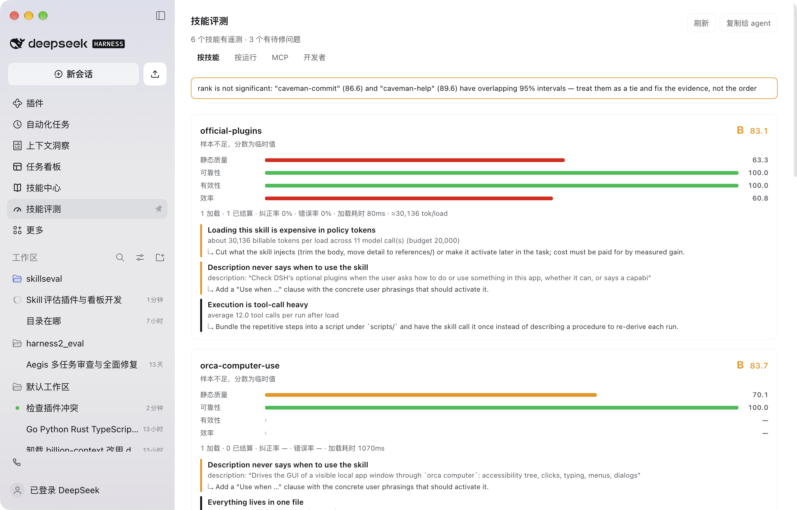
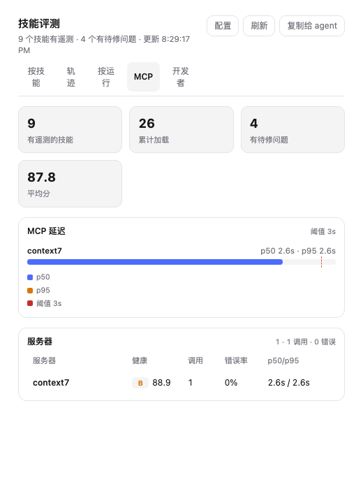
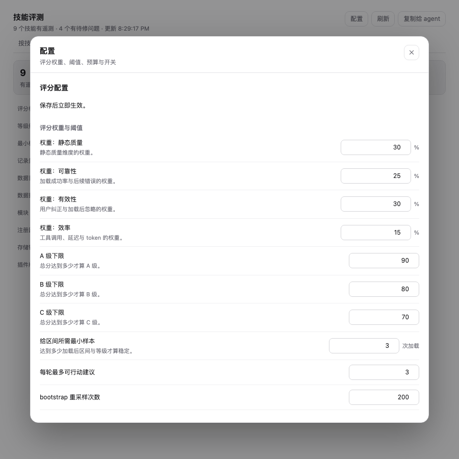

# dsh-skill-eval

[](https://www.npmjs.com/package/dsh-skill-eval)
[](LICENSE)
[](https://github.com/carlslin/dsh-skill-eval/releases)

A skill has no report card. This plugin keeps one.

Every time a skill loads, it quietly writes down what happened next: did the load
work, did the following tool calls fail, did you have to correct the answer, did
the skill get ignored, did it collide with another skill, what did it cost. After
a few runs each skill has a 0–100 score and a short list of concrete edits.

It ships as a DeepSeek Harness (DSH) plugin, and that matters: most skill checkers
review the skill _file_, while the signals above only exist while the harness is
running.

New here? Install it (`dsh plugin --profile desktop add dsh-skill-eval`), use a
skill once, then read the strip under that turn.

## 中文速览 · TL;DR for Chinese readers

- 每次 `skill` 加载后记录执行情况：加载成败、后续工具报错、用户是否推翻、是否被忽略、是否撞车、花了多少。
- 每个技能 0–100 分（A≥90 / B≥80 / C≥70 / D≥60 / F<60），带 95% 区间；区间重叠就标“排名不显著”，样本不够时不下结论。
- 入口只有三个：回合下方结果条、侧边栏「技能评测」面板、设置 → 插件 → `dsh-skill-eval` 的配置页。
- 建议靠规则生成，每条都带触发数字和可执行的修复；中文界面下标题与修复为中文。
- 完整中文文档：[README.zh.md](README.zh.md)；入口清单：[docs/ENTRYPOINTS.md](docs/ENTRYPOINTS.md)。

## What you get

- **A result strip** under every finished turn that used a skill: the score, this
  turn's calls and errors, and the fixes you can expand (no tokens, no popup).
  The old popup is opt-in (`window.__SEV_ENABLE_POPUP__ = true`).
- **A board** at `/skill-eval/board/<version>` with grades, dimension bars and the
  next edits for every skill, plus evidence chips (feedback, outcomes, approvals,
  compactions, model) and the latest edit's before/after score.
- **An agent tool**, `skill_eval_report`, so the agent reads its own numbers
  instead of guessing. `/skill-eval [skill]` gives you the same report in the
  composer.
- **A local record**: an append-only JSONL file at
  `$DSH_HOME/skill-eval/$DSH_PROFILE/events.jsonl`, capped at 8 MB (the oldest
  half is trimmed; the `edit` audit ledger stays). Nothing is uploaded.

## Screenshots

| Skills board                              | MCP tab                                  | Scoring settings                                   |
| ----------------------------------------- | ---------------------------------------- | -------------------------------------------------- |
|  |  |  |

More real-window screenshots and the per-screen notes:
[docs/UI-REVIEW.md](docs/UI-REVIEW.md).

## What goes into a score

| dimension     | weight | signal                                                                                   |
| ------------- | ------ | ---------------------------------------------------------------------------------------- |
| static        | 0.30   | description, trigger cues, progressive disclosure, size, examples                        |
| reliability   | 0.25   | load success × post-load tool error rate                                                 |
| effectiveness | 0.30   | explicit ratings, text corrections, ignored loads, sibling collisions, produced outcomes |
| efficiency    | 0.15   | tool calls per run, load latency, context compactions                                    |

Evidence comes from the durable DSH event stream: `feedback/message-put` (explicit
ratings), `deliverables/presented`, `workspace/changes`, `job/settled`,
`team/task`, `approval/asked|decided`, `compaction/start`, `model/selection` and
`agent-preset/selected`. Authoring checks score the rendered catalog
description — whitespace-normalized and capped — not the raw frontmatter.

Grades: `A ≥ 90`, `B ≥ 80`, `C ≥ 70`, `D ≥ 60`, `F < 60`.

### How to read a score

A score is a summary, not a verdict. Every number carries a 95% interval; when
two skills' intervals overlap, the board says the ranking is not significant.
Fewer than `minSamples` loads (default 3) makes a score provisional. A dimension
with no evidence is dropped and the remaining weights are rescaled instead of
counting as zero. The full rubric and formulas live in
[docs/DETAIL.md](docs/DETAIL.md).

Advice is never generic. Each item carries the number that triggered it and a
concrete edit:

```
🛑 [critical] The user rejects the result right after the skill runs (effectiveness)
   evidence: 67% of runs were followed by a correcting message (e.g. "不对，页眉没删掉")
   fix: The body likely ignores stated constraints. Tighten the output contract and
        the "do not" list; add a short self-check the model must run before answering.
```

## Entry points

Everyday use is three places only:

| Goal                   | Where                                                                                      |
| ---------------------- | ------------------------------------------------------------------------------------------ |
| See this turn's result | the result strip under a completed turn (score, calls/errors, next fix, edit history)      |
| Open the board         | the **Skill eval** panel icon in the sidebar (main panel, same seat as the context plugin) |
| Change scoring         | **Settings → Plugins → the `dsh-skill-eval` bundle page → Configure**                      |

Web board: `/skill-eval/board/<version>` · web settings: `…/config` · JSON:
`…/data/<version>`. Slash commands, agent tools, terminal checks and debug
switches: [docs/ENTRYPOINTS.md](docs/ENTRYPOINTS.md).

```bash
dsh-skill-eval-doctor   # packaging pre-flight (release gate with --release)
dsh-skill-eval-accept   # generation & data contract (17 checks)
dsh-skill-eval-verify   # product surfaces (7 checks + 2 manual, after a reload)
```

## Install

Requirements: DeepSeek Harness with plugin bundles (the package declares
`dsh.engines.dsh >= 0.2.0`) and Node.js ≥ 20 for the CLI helpers.

From npm:

```bash
dsh plugin --profile desktop add dsh-skill-eval
```

From GitHub source. A clone contains `src/` only. `index.js`, `lib/`, `scripts/`
and `client.js` are build output, and the host loads those files. Pack the
compiled tree and install the tarball. Do not point `dsh plugin add` or
`plugin_manager` → `install_bundle` at the git checkout.

```bash
git clone https://github.com/carlslin/dsh-skill-eval.git
cd dsh-skill-eval
npm install          # prepare compiles the runtime files
npm pack             # tarball of those files, not the git tree
dsh plugin --profile desktop add "$PWD"/dsh-skill-eval-*.tgz
```

From a packed release tarball (what a published build ships):

```
dsh plugin --profile desktop add "$PWD/dist/dsh-skill-eval-<version>.tgz"
```

The npm package and the release tarball are prebuilt. A git checkout is not.
Editing `src/client/*.ts` requires `npm run build:client`, which uses the
`typescript` devDependency to strip types and write `client.js`. After install,
refresh the GUI: the board is the **Skill eval** panel icon in the sidebar,
settings live under **Settings → Plugins → `dsh-skill-eval`**.

## Use

- **Result strip** under every completed turn: score chip, calls/errors, next
  fix and edit history (zero tokens).
- **Board**: skills / steps / runs / MCP / dev tabs, with next steps and charts
  (score spread, skill trend, evidence coverage, MCP latency, session activity).
  The **steps** tab scores each loop step and compares recent turns.
- **Copy issues**: on a skill card, one click copies that card's current issues,
  score, dimensions and evidence as a self-contained Markdown repair task; every
  advice row still copies on its own.
- **Agent**: ask "how did `pdf-tools` perform?" — the agent calls
  `skill_eval_report`; before editing a skill it is told to call
  `skill_eval_review` first.
- **Slash commands**: `/skill-eval` (summary), `/skill-eval <skill>`,
  `loop [all]`, `validity`, `history`, `impact`, `mcp`, `runs`, `turns`, `dev`,
  `config`, `accept`.
- **Read-only Inspect**: provider `skill-eval`, methods
  `summary|skill|mcp|runs|edits|standard`.
- To improve a skill: act only on `critical`/`warning` items, apply the `fix`
  lines, then re-read after a few more loads.

## Config

The form lives in the bundle page; the same values can be seeded in config or
`settings.json`. The essentials:

```yaml
enabled: true
windowToolCalls: 12 # tool calls that count as evidence for one load (live)
windowTtlMs: 1800000 # how long an open window waits for follow-up work
minSamples: 3 # loads before a score stops being provisional
weights: { static: 30, reliability: 25, effectiveness: 30, efficiency: 15 }
thresholds: { excellent: 90, good: 80, pass: 70 }
tokenBudgetPerLoad: 20000 # billable tokens per load before efficiency/advice react
adviceNoiseFloor: true # advice must clear its 95% interval to stay critical
redactCorrections: false # true = store "[redacted N chars]" instead of user text
turnReports: true # one board per settled turn under reports/turns/
turnReportsKeep: 50 # per-turn boards to keep
reportOnTurnEnd: true # write reports/latest.md + latest.json after each turn
# snapshots: { latest: true, turns: true, keep: 50 } # same trio as one object
promptHint: true # the one-line system-prompt hint; false = zero fixed cost
registerReviewTool: true # skill_eval_review: leakage critic + audit ledger
```

Full key list (31 settings incl. pruning, edit budget, cache weight, MCP tool
thresholds, dashboard path and the snapshots trio):
[docs/DETAIL.md](docs/DETAIL.md#configuration-keys).
`DSH_SKILL_EVAL_DIR` overrides the data directory; `$DSH_HOME/skill-eval/$DSH_PROFILE`
is the default. Data/settings JSON stays under the canonical `/skill-eval`
base and is mirrored under a custom `dashboardPath`, so a moved board keeps
working after a hot reload.

## Release

See [docs/RELEASE.md](docs/RELEASE.md) for the checklist, packing commands and
the clean-profile smoke test. `npm run release:check` runs the doctor gate, the
test suite and the live acceptance; `node scripts/doctor.mjs --release` verifies
the matching `dist/` artifact.

## Build

Editing `src/client/*.ts` requires rebuilding the single-file browser bundle:

```bash
npm run compile        # tsc → emitted index.js/lib/*.js/scripts/*.mjs + client.js
npm run build:client   # same emit; works when scripts/ is not already built
npm run typecheck      # strict tsc for host, client and test projects
npm run build          # format check → lint → compile → doctor → the test suite
npm run build:fast     # compile + doctor only
npm run build:pack     # full build + dist/dsh-skill-eval-<version>.tgz
npm run build:install  # pack + install into the desktop profile
```

`scripts/build.mjs` runs the same commands as the release checklist; add
`--fix` to format before checking, `--install=<profile>` for another profile.

## Tests

```
npm test
npm run e2e   # one real headless turn; needs DEEPSEEK_API_KEY
```

`npm run e2e` installs the current build into a throwaway headless profile,
writes a probe skill, runs one real turn, then checks the durable telemetry,
report JSON, snapshot and board HTML. Without `DEEPSEEK_API_KEY` it prints
**SKIP** instead of failing; `--require-credential` turns that into exit 2.

`npm test` compiles first, then runs the suite against `src/` (not a previous
`lib/*.js`). The suite command is
`node --experimental-strip-types --test "test/**/*.test.ts"`; the explicit
glob is required because Node 22/24 treat a bare directory argument as an entry
module. Scoring bands, static checks, correction detection,
window lifecycle (turn-end snapshot → correction → close), store round-trip with
a torn line, analyzer join, markdown/HTML rendering incl. escaping and bilingual
advice copy, host route registration under duplicate-route pressure, and the
client surfaces mounted in jsdom.

## Feedback

Issues are the intake: <https://github.com/carlslin/dsh-skill-eval/issues>.
Include the plugin version (`dsh plugin list`), the DSH version and profile, what
the board showed before/after, and the steps to reproduce. On the skills board,
**Copy issues** on a skill card produces a self-contained Markdown block you can
paste into the report.

Telemetry never leaves the machine: events live in
`$DSH_HOME/skill-eval/$DSH_PROFILE/events.jsonl`, and `redactCorrections: true`
stores `[redacted N chars]` instead of the user's text. See
[docs/DETAIL.md](docs/DETAIL.md) for the record schema before attaching excerpts.

## More docs

- [docs/AUDIT.md](docs/AUDIT.md) — multi-layer audit: findings, fixes, residuals
- [docs/CODE-REVIEW.md](docs/CODE-REVIEW.md) — code-hygiene review: dead code, duplication, cleanup
- [docs/UI-REVIEW.md](docs/UI-REVIEW.md) — real-window walkthrough with screenshots (`docs/ui/`)
- [docs/ENTRYPOINTS.md](docs/ENTRYPOINTS.md) — every entry point, including slash commands and debug switches
- [docs/WORKFLOW.md](docs/WORKFLOW.md) — load → measure → score with intervals → advice → screen edits → re-measure
- [docs/DETAIL.md](docs/DETAIL.md) — rubric, record schema, full configuration keys, why this exists
- [docs/RRSI-NOTES.md](docs/RRSI-NOTES.md) — research notes and what we borrowed
- [docs/COMPARISON.md](docs/COMPARISON.md) — prior art and what each misses
- [docs/RELEASE.md](docs/RELEASE.md) — release checklist, tag/release sync and clean-profile smoke test
- [docs/DEV-RELOAD.md](docs/DEV-RELOAD.md) — hot-reload recipe and disposable-profile verification
- [CHANGELOG.md](CHANGELOG.md) — release history

## Known limits

- Loads are recorded from `skill` tool calls and user-typed `/skill-name` invocations; a skill the harness activates without either is invisible.
- Explicit ratings win; without a rating, effectiveness falls back to the next user message. Outcome evidence counts deliverables, workspace changes, settled jobs and completed team tasks.
- Subagent and team windows are recorded with `agentKind`/`agentName` but still aggregate into the same skill score.
- Authoring checks use the rendered catalog description; the catalog cap is the host's default (500) unless the durable catalog message was captured.
- Advice evidence keeps measured ids/numbers in English even in the Chinese UI; evidence tables escape Markdown so skill names and user text cannot break the report layout.
- Telemetry is bounded to 8 MB (`events.jsonl` rotates to its newest half, keeping the `edit` audit ledger first). Step rows are the dominant growth in long sessions; per-skill trends keep the last 12 loads and runs keep the last 20 sessions.
- Small samples never report strong significance: rate gates with fewer than 8 windows cap at `info`, and prune advice requires at least 6 loads (the configured `pruneMinLoads`, default 12) plus a bootstrap interval below the bar.
- Privacy: user correction text and explicit feedback notes are stored by default; set `redactCorrections: true` to keep only `[redacted N chars]`. Report/board reads reject cross-site fetch metadata.
