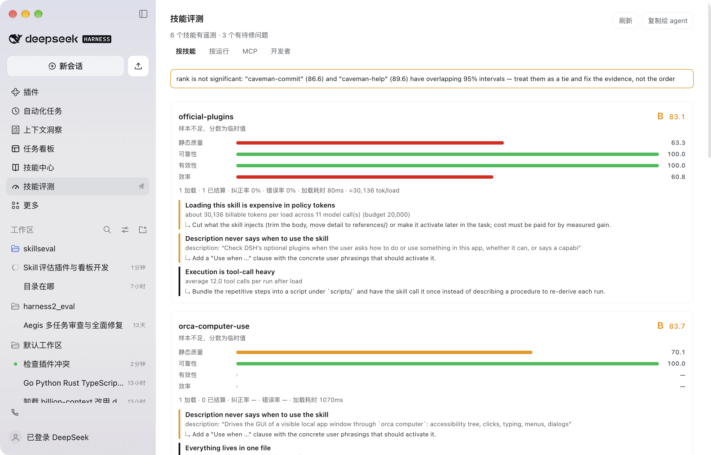
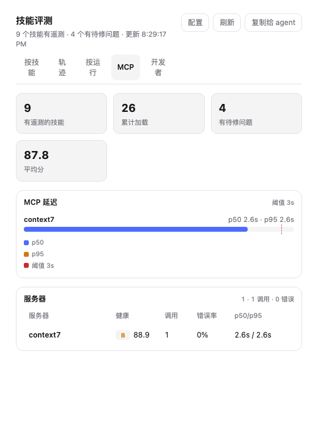
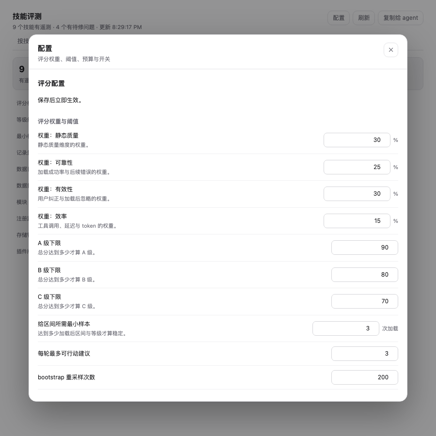

# dsh-skill-eval（技能评测）

[](https://www.npmjs.com/package/dsh-skill-eval)
[](LICENSE)
[](https://github.com/carlslin/dsh-skill-eval/releases)

记录 **skill 加载之后**真实发生了什么：加载成败、后续工具报错、用户有没有推翻、
技能是否被忽略、是否与兄弟技能碰撞、花了多少 token。每个技能打 0–100 分，并把
证据转成 agent 可以直接执行的修复建议。

大多数技能质量工具检查的是技能*文件*；这个插件检查的是*执行*。这些信号只存在于
运行中的 harness 里，所以它是一个 DSH 插件，而不是一个 CLI。

## English at a glance

- Telemetry after every skill load; 0–100 scores with 95% bootstrap intervals.
- Three human entry points: the per-turn result strip, the sidebar **Skill eval**
  board panel, and **Settings → Plugins → `dsh-skill-eval`**.
- Rule-based advice with measured evidence, localized into Chinese in the
  Chinese UI. Full English docs: [README.md](README.md).

## 产出

- **对话内结果条**：每个加载过技能的完成回合下方一行，显示分数、本轮调用/报错、
  可展开的修复清单（零 token，不弹窗）。旧弹窗保留但需手动开启
  （`window.__SEV_ENABLE_POPUP__ = true`）。
- `skill_eval_report` 工具 —— agent 直接读自己的遥测，不再靠猜
- `/skill-eval [技能]` 命令 —— 在输入框里看同一份报告
- `/skill-eval/board/<版本>` —— HTML 看板：等级、维度条、优先修复
- 追加式 JSONL 遥测：`$DSH_HOME/skill-eval/$DSH_PROFILE/events.jsonl`
  （上限 8 MB，写满后丢弃最旧的一半，长期运行也不会无限增长）

## 截图

| 技能看板                              | MCP 标签                                  | 评分配置                                      |
| ------------------------------------- | ----------------------------------------- | --------------------------------------------- |
|  |  |  |

更多真实窗口截图与逐屏记录：[docs/UI-REVIEW.md](docs/UI-REVIEW.md)。

## 评分一眼看懂

| 维度     | 权重 | 信号                                 |
| -------- | ---- | ------------------------------------ |
| 静态质量 | 0.30 | 描述、触发线索、渐进披露、体量、示例 |
| 可靠性   | 0.25 | 加载成功率 × 加载后工具错误率        |
| 有效性   | 0.30 | 用户纠正、加载后被忽略、兄弟技能碰撞 |
| 效率     | 0.15 | 每次运行的调用数、加载延迟           |

等级：`A ≥ 90`、`B ≥ 80`、`C ≥ 70`、`D ≥ 60`、`F < 60`。每个分数带 95% bootstrap
区间；区间重叠时排名标为不显著。没有证据的维度会被丢弃并重新分配权重，所以新技能
不会因为没历史而被惩罚。完整评分规则、记录 schema 与公式：[docs/DETAIL.md](docs/DETAIL.md)。

建议不是套话：每条都带触发它的数字和具体改法，中文界面下标题与修复为中文。

## 入口

日常只用三个地方：

| 目标         | 位置                                                           |
| ------------ | -------------------------------------------------------------- |
| 看本回合结果 | 完成回合下方的结果条（分数、调用/报错、下一处修复、改动记录）  |
| 打开看板     | 侧边栏 **「技能评测」** 面板图标（主面板，与上下文插件同位置） |
| 改评分标准   | **设置 → 插件 → `dsh-skill-eval` 包页面 → 配置**               |

网页版看板：`/skill-eval/board/<版本>` · 网页配置：`…/config` · JSON：
`…/data/<版本>`。对话命令、agent 工具、终端检查与调试开关见
[docs/ENTRYPOINTS.md](docs/ENTRYPOINTS.md)。

```bash
dsh-skill-eval-doctor   # 打包预检（--release 为发布门禁）
dsh-skill-eval-accept   # 数据契约与生成检查（17 项）
dsh-skill-eval-verify   # 产品面可达（7 项 + 2 项手动，重载后）
```

## 安装

要求：带插件 bundle 能力的 DeepSeek Harness（包内声明 `dsh.engines.dsh >= 0.2.0`），
CLI 辅助脚本需要 Node.js ≥ 20。

从 npm 安装：

```bash
dsh plugin --profile desktop add dsh-skill-eval
```

从 GitHub 源码安装。克隆下来只有 `src/`。`index.js`、`lib/`、`scripts/`、
`client.js` 都是构建产物，宿主加载的是这些文件。先打包再安装 tarball。不要把
`dsh plugin add` 或 `plugin_manager` → `install_bundle` 指到 git 检出目录。

```bash
git clone https://github.com/carlslin/dsh-skill-eval.git
cd dsh-skill-eval
npm install          # prepare 会编译出运行时文件
npm pack             # 打的是这些文件，不是 git 树
dsh plugin --profile desktop add "$PWD"/dsh-skill-eval-*.tgz
```

从发布 tarball 安装（发布产物）：

```
dsh plugin --profile desktop add "$PWD/dist/dsh-skill-eval-<版本>.tgz"
```

npm 包和发布 tarball 是预构建的。git 检出目录不是。修改 `src/client/*.ts` 后要跑
`npm run build:client`，它用 `typescript` 这个 devDependency 去掉类型并写出
`client.js`。装完刷新 GUI：看板是侧边栏的
「技能评测」面板，配置在 **设置 → 插件 → `dsh-skill-eval`**。

## 用法

- **结果条**：完成回合下方，分数、调用/报错、下一处修复、改动记录（零 token）。
- **看板**：技能 / 轨迹 / 运行 / MCP / 开发者标签，含下一步、效度摘要与 SVG 图表；「轨迹」逐步打分并对比最近几个回合。
- **让 agent 看**：直接问「`pdf-tools` 表现怎么样」—— agent 会调 `skill_eval_report`；
  改技能前它被告知先调 `skill_eval_review` 做泄漏审查。
- **对话命令**：`/skill-eval`、`/skill-eval <技能>`、`loop [all]`、`validity`、
  `history`、`impact`、`mcp`、`runs`、`turns`、`dev`、`config`、`accept`。
- **只读 Inspect**：provider `skill-eval`，方法 `summary|skill|mcp|runs|edits|standard`。
- **怎么改技能**：只处理 `critical`/`warning`，照 `fix` 改，再用几轮真实加载重测。

## 配置

配置在包页面的原生表单里；也可以用 config 或 `settings.json` 预置。常用项：

```yaml
enabled: true
windowToolCalls: 12 # 一次加载的证据窗口内工具调用数
minSamples: 3 # 样本达到多少后分数不再算临时值
weights: { static: 30, reliability: 25, effectiveness: 30, efficiency: 15 }
thresholds: { excellent: 90, good: 80, pass: 70 }
tokenBudgetPerLoad: 20000 # 单次加载可计费 token 预算
adviceNoiseFloor: true # 建议必须越过 95% 区间才保持 critical
turnReports: true # 每个结算回合写一份看板到 reports/turns/
promptHint: true # 系统提示里一行提示；false = 零固定成本
registerReviewTool: true # skill_eval_review：泄漏审查 + 审计账本
```

全部 25 项（含剪枝、编辑预算、缓存权重、面板路径、Inspect provider、MCP 阈值）：
[docs/DETAIL.md](docs/DETAIL.md#configuration-keys)。`DSH_SKILL_EVAL_DIR` 可覆盖数据目录，
默认 `$DSH_HOME/skill-eval/$DSH_PROFILE`。

## 测试

```
npm test
```

`npm test` 会先编译，再对着 `src/` 跑套件（不是上一份 `lib/*.js`）。测试命令是
`node --experimental-strip-types --test "test/**/*.test.ts"`；Node 22/24 会把裸目录当成
入口模块，必须显式 glob。评分分档、静态检查、纠正识别、窗口生命周期（回合结束快照 →
纠正 → 关闭）、带残缺行的存储往返、分析器 join、Markdown/HTML 渲染（含转义与中文
建议文案）、重复路由压力下的宿主路由注册，以及客户端的 jsdom 挂载测试。

## 更多文档

- [docs/AUDIT.md](docs/AUDIT.md) —— 多层审计：问题、修复与遗留
- [docs/CODE-REVIEW.md](docs/CODE-REVIEW.md) —— 代码卫生：死代码、重复实现与清理
- [docs/UI-REVIEW.md](docs/UI-REVIEW.md) —— 真实窗口逐屏记录 + 截图（`docs/ui/`）
- [docs/ENTRYPOINTS.md](docs/ENTRYPOINTS.md) —— 全部入口、命令与调试开关
- [docs/WORKFLOW.md](docs/WORKFLOW.md) —— 加载 → 测量 → 区间评分 → 建议 → 审查改动 → 重测
- [docs/DETAIL.md](docs/DETAIL.md) —— 评分规则、记录 schema、完整配置项
- [docs/RELEASE.md](docs/RELEASE.md) —— 发布检查表与干净 profile 冒烟
- [docs/COMPARISON.md](docs/COMPARISON.md) —— 公开实现对比
- [docs/DEV-RELOAD.md](docs/DEV-RELOAD.md) —— 热重载与一次性 profile 验证
- [CHANGELOG.md](CHANGELOG.md) —— 版本历史

## 已知盲区

- 记录 `skill` 工具调用与用户输入的 `/skill-name`；harness 自动激活、既不调工具也不输命令的技能看不到。
- 有效性推断自下一条用户消息，不是任务结论。
- 中文界面下建议的 evidence 仍保留测量用的英文 id/数字。
- 遥测只追加、不自动清理（每次加载一对小记录）。
